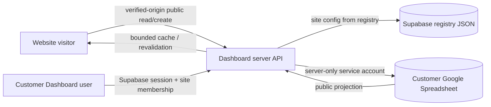

# AXORA Google Sheets Integration Architecture

**Status:** incremental implementation in the dashboard; template migration and live Google verification remain incomplete. This is not a claim that the cross-site flow is live.  
**Data ownership:** customer business records stay in Google Sheets. Supabase remains identity/tenant/configuration infrastructure only. The schema extension described here is JSON registry metadata; it does not require changing existing database tables.

## Existing implementation conflicts (inspected before changes)

| Area | Existing state | Conflict with requested standard |
|---|---|---|
| Dashboard schema | `admin_dashboard/src/lib/google/types.ts` and `google-repository.ts` support only Products, Categories, Orders, Customers, Settings and InventoryLogs. | Restaurant, service-business and profile resources do not have typed adapters. |
| ORVANTE store | `online_store_template/apps-script/Code.gs` has an independent Apps Script client, hard-coded workbook mapping, and Products/Users/Orders/Sessions/LoginCodes tabs. | It bypasses dashboard membership, provisioning, canonical schema versioning, and dashboard synchronization. It is a working separate connector that must be migrated or explicitly supported as a legacy adapter. |
| Other templates | Template 2 has source-code products and optional order webhook; coffee and business profile have static content/forms and no Sheets layer. | Three templates have no Sheets-backed adapter. Coffee currently returns success from local-only checkout/contact handlers. |
| Site configuration | Dashboard registry has `id`, `businessType`, `sheets.spreadsheetId`, `sheets.connectionStatus`, and `sheets.lastSyncAt`. | No standard `schema_version`, `enabled_modules`, `last_successful_sync`, or monotonic `configuration_version` contract. |
| Provisioning | Dashboard can inspect/save an existing spreadsheet mapping and create tabs as part of ordinary setup. | No create-spreadsheet provisioning workflow, durable idempotency record, verification transaction, or provisioning error history. |
| Authorization | Dashboard admin routes/actions use Supabase-backed `requireStoreAdmin`/`requireSuperAdmin` and server store scope. | Independent websites do not use that membership gate. Spreadsheet ID alone cannot authorize a request. |
| Reads and synchronization | Dashboard’s own `/store/[slug]` renders Sheets-backed data with a 20-second process cache and path revalidation. | Separate customer deployments are not connected to that invalidation path. |
| Operations | Dashboard maps stable record IDs to sheet rows, but the adapter performs mutations by row coordinates internally. | The API contract must keep row numbers private implementation details and use stable IDs plus optimistic concurrency for updates/deletes. |
| Credentials and failures | Dashboard service account is server-only, with REST calls, timeouts and bounded retry. Current local configuration has no Sheets credential variables. | No real API request or end-to-end test can currently establish live success. |

## Access policy

- **Admin CRUD:** require an authenticated dashboard user, active site membership, and permission for the specific site/resource/action. Resolve the site from the server session and registry; never accept `spreadsheet_id` as authority.
- **Published reads:** anonymous visitors may read only public fields from an active, published site. Resolve site identity against a verified active domain from the request `Origin`; return a strict projection and apply CORS/rate/cache controls. No spreadsheet IDs, configuration, private customer/order data, or arbitrary tab access are returned.
- **Visitor submissions:** public order, reservation, appointment, and contact-inquiry routes may create only validated records for the verified originating site. They cannot read, update, or delete data. Apply rate limits, idempotency, server-computed prices/availability where applicable, and spam controls.
- **Service identity:** a generated website may call public read/create endpoints with its registered origin; it receives no Google credential or privileged integration token. Admin writes remain dashboard-session operations.

## Target data flow



Axora remains a separate main platform. The dashboard remains a separate customer admin/data API. Each template remains an independent project and deployment. `axora-website-factory` is the future provisioning client; no new repository is assumed here.

## Site integration configuration contract

The canonical external contract is snake_case. Spreadsheet IDs are server-side configuration values and are never treated as credentials.

```ts
interface SiteIntegrationConfig {
  site_id: string;
  business_type: "online_store" | "restaurant" | "service_business" | "business_profile";
  spreadsheet_id: string; // server-only
  schema_version: number;
  enabled_modules: string[];
  integration_status: "unconfigured" | "provisioning" | "connected" | "error" | "local";
  last_successful_sync: string | null;
  configuration_version: number;
}
```

Persist integration fields as additive JSON within the existing server-side store registry. Existing records are read with safe defaults. Do not add/rename Supabase columns or migrate business records. Credential material remains in server environment/managed secret storage and is never part of this object.

## Provisioning lifecycle

1. Super Admin starts provisioning for an existing site; site and business type come from the registry, not the request body.
2. Require an idempotency key. Persist a provisioning attempt and use a Drive `appProperties` marker so retry can discover a spreadsheet created before a process failure.
3. Create the spreadsheet server-side, create the tabs/headers for the site’s enabled modules, and set the schema version.
4. Read metadata and required headers back; perform a disposable write/read probe in a dedicated integration-health location (never customer data rows).
5. Save mapping/status/version to the registry only after verification. Record sanitized failure code and retry state on failure.
6. Repeated idempotency key returns the original attempt/result and does not create a second workbook.

The live provisioning path requires the Sheets API plus Drive `drive.file` scope. A server-side fake cannot prove Google permissions, quotas, or real idempotency; those remain staging acceptance checks.

## Implemented in the dashboard checkout

- `src/lib/google/schema-registry.ts`, `data-contracts.ts`, `typed-adapter.ts` and `site-config.ts` define typed v1 records, business-specific tabs, server validation, public-field projections, stable IDs, extensions and optimistic version checks.
- `src/lib/google/provisioning.ts` creates or finds a workbook by an opaque Drive `appProperties` marker, provisions tabs/headers, verifies them, performs a disposable write/read probe and removes the probe tab. Provisioning is serialized by the platform lock and exposed from the site detail page to Super Admins.
- `GET /api/public/site-data/{module}` and create-only `POST` resolve the tenant from the exact registered Origin/domain state. `OPTIONS` restricts CORS to that registered origin. Public reads are a strict projection; intake writes include orders, reservations, appointments and contact inquiries.
- `GET/POST/PATCH/DELETE /api/admin/site-data/{module}` require a dashboard session, derive a store-admin tenant from the membership assignment, require module permissions and never accept a spreadsheet ID. Updates/deletes use stable IDs and `expectedUpdatedAt`; delete is confirmed and soft.
- Registry metadata remains in the existing file-backed configuration or existing registry adapter; no Supabase business-data table/schema was added. Sheets remain the customer business-data source.
- Storefront orders have server-computed item prices and e-commerce shipping fees. Public intake audit entries omit visitor PII. The legacy dashboard data reader hides records with a `DeletedAt` tombstone.

## Implemented limitations and remaining work

- Provisioning error state and a sanitized code are saved in the existing registry. There is not a separate durable job-attempt ledger, and the idempotency key remains client-supplied; retry with the same key to find the same Drive file.
- Google API retries are bounded in the existing Sheets client. Visitor/admin rate limits and public response cache are process-local; use a shared backing service before multi-instance production. Public cache TTL is 15 seconds; the dashboard’s older repository cache is 20 seconds. There is no cross-deployment push revalidation or ETag/revision endpoint.
- Per-resource writes are serialized through the platform lock when the shared platform DB is enabled. Optimistic `updatedAt` checks still rely on the read/patch pair, so external edits made directly in Sheets and races across tools cannot provide a Google Sheets atomic compare-and-set guarantee.
- The current legacy store-management screens continue using `google-repository.ts`; generic typed CRUD endpoints are available, but the restaurant/service/profile admin screens have not been built. Existing e-commerce screens share the workbook and should be used only with their compatible legacy columns.
- `online_store_template_2` reads products/categories through a same-origin server proxy and can submit checkout through the public endpoint; starter hero/search/editorial sections remain static fallbacks. Coffee menu and visitor order/contact calls are wired to the endpoint with static menu fallback. Business-profile published pages/gallery/articles render from public endpoints, and contact can submit when configured. ORVANTE remains on its separate Apps Script backend to preserve OTP/customer/order behavior pending an explicit migration test.
- The endpoint contract is implemented and mock-tested only. No service-account credentials were found in this checkout, so provisioning and the complete dashboard-to-live-site flow have not passed a real Google test.

## Cache and freshness

- Cache only public projections, keyed by site ID, schema/configuration version and resource. Do not cache admin/private reads in a shared cache.
- Invalidate the matching resource after confirmed dashboard writes. Revalidate the internal dashboard storefront and increment a site data revision for external templates to observe.
- Public reads carry `ETag`/revision and a short bounded `stale-while-revalidate` window. Mutations return only after Sheets confirms success.
- If external deployments cannot receive push revalidation, poll using conditional requests. State the freshness bound in site configuration and do not promise instantaneous propagation.

## Readiness statement

The current repository audit found no live Google credentials and no real customer spreadsheet verification. Code/tests must be described as mocked until a real disposable spreadsheet passes provisioning, CRUD, tenancy, error and website-refresh acceptance in `INTEGRATION_TESTS.md`.
